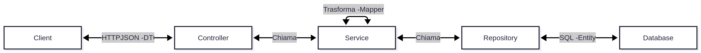
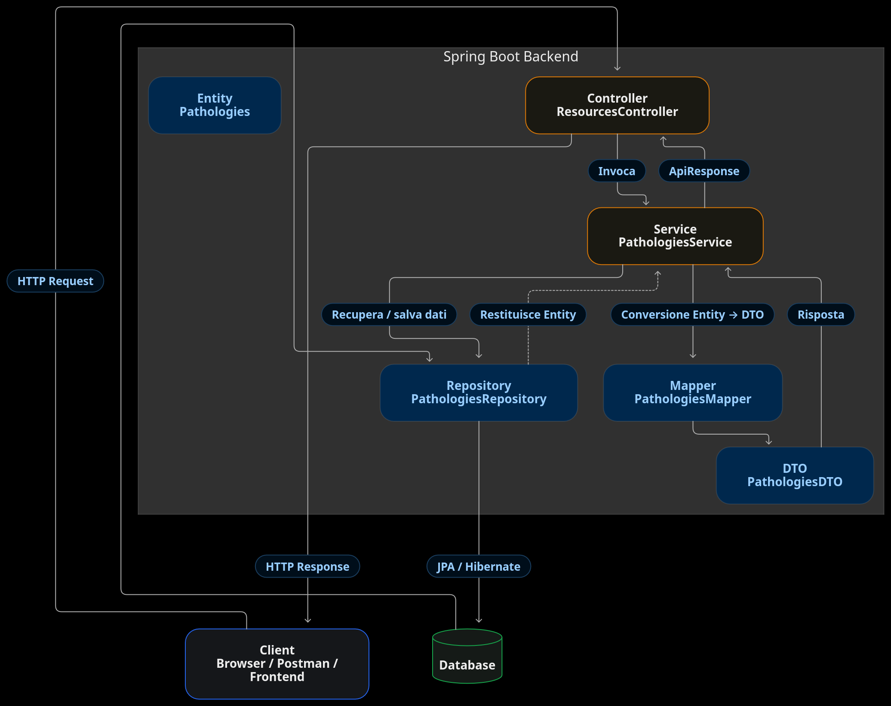

# Spring Boot – Architettura e componenti fondamentali

## 1. Introduzione a Spring Boot

### 1.1 Cos'è Spring Boot?

Spring Boot è un framework basato su Spring, progettato per semplificare lo sviluppo di applicazioni Java, in particolare applicazioni Web, REST API e applicazioni backend.

Nasce con l'obiettivo di ridurre la quantità di configurazione manuale necessaria per realizzare un'applicazione Spring, fornendo configurazioni automatiche e strumenti già pronti all'utilizzo.

Tra le sue caratteristiche principali troviamo:

- **Auto-Configuration:** configura automaticamente numerosi componenti dell'applicazione in base alle dipendenze presenti.
- **Dependency Injection:** gestisce automaticamente le dipendenze tra gli oggetti.
- **Embedded Server:** permette di eseguire l'applicazione utilizzando un server integrato, come Tomcat.
- **Starter Dependencies:** mette a disposizione dipendenze preconfigurate per funzionalità comuni.
- **Production Ready:** offre strumenti per logging, monitoraggio e gestione dell'applicazione.

### 1.2 Perché utilizzare Spring Boot?

Sviluppare un backend Java senza un framework può richiedere la gestione manuale di numerosi aspetti infrastrutturali, come:

- Creazione e gestione degli oggetti.
- Configurazione delle connessioni al database.
- Gestione delle richieste HTTP.
- Serializzazione e deserializzazione dei dati.
- Gestione centralizzata degli errori.

Spring Boot permette di delegare gran parte di queste responsabilità al framework, consentendo allo sviluppatore di concentrarsi maggiormente sulla logica applicativa.

Il risultato è un'applicazione più modulare, manutenibile e facilmente estendibile.

---

## 2. Il concetto di IoC – Inversion of Control

Uno dei concetti fondamentali dell'ecosistema Spring è l'**Inversion of Control (IoC)**.

### 2.1 Cos'è l'Inversion of Control?

Tradizionalmente, quando sviluppiamo un'applicazione Java, siamo noi a creare direttamente gli oggetti e a gestirne le dipendenze.

Ad esempio:

```java
public class PathologiesController {

    private PathologiesService service;

    public PathologiesController() {
        this.service = new PathologiesService();
    }
}
```

In questo caso il Controller è responsabile della creazione del Service.

Questo introduce un forte accoppiamento tra le due classi: il Controller conosce direttamente il modo in cui viene istanziato il Service.

Con Spring, invece, il controllo della creazione e della gestione degli oggetti viene delegato al framework.

Spring mette a disposizione un contenitore chiamato **IoC Container**, che si occupa di:

- Creare gli oggetti necessari.
- Gestire il loro ciclo di vita.
- Risolvere le dipendenze tra i componenti.
- Fornire gli oggetti alle classi che ne hanno bisogno.

Gli oggetti gestiti dal contenitore Spring vengono chiamati **Bean**.

### 2.2 Dependency Injection (DI)

La Dependency Injection è il meccanismo attraverso il quale Spring (e altri framework tipo Angular) realizza concretamente l'Inversion of Control.

Vediamo come cambia il nostro esempio:

```java
@RestController
public class PathologiesController {

    private final PathologiesService service;

    public PathologiesController(PathologiesService service) {
        this.service = service;
    }
}
```

Non utilizziamo più `new PathologiesService()`.

Spring riconosce che il Controller necessita di un'istanza di `PathologiesService` e provvede a iniettarla automaticamente.

Questo approccio offre diversi vantaggi:

- Riduce l'accoppiamento tra le classi.
- Facilita i test automatici.
- Migliora la manutenibilità.
- Permette di sostituire facilmente le implementazioni.

**Nota:** la Constructor Injection, mostrata nell'esempio, è generalmente la modalità consigliata per iniettare dipendenze obbligatorie.

---

## 3. Organizzazione del progetto: metodologia By Feature

Il progetto utilizza la metodologia di organizzazione **By Feature**.

Questa metodologia prevede di organizzare il codice raggruppando le classi in base alla funzionalità o al dominio applicativo a cui appartengono, anziché dividerle esclusivamente per tipologia tecnica.

Ad esempio, un'organizzazione tradizionale potrebbe essere:

```text
controller/
service/
repository/
entity/
dto/
```

In un'organizzazione By Feature, invece, troviamo:

```text
resources/
    pathology/
        PathologiesDTO.java
        Pathologies.java
        PathologiesMapper.java
        PathologiesRepository.java
        PathologiesService.java
    arrival_mode/
        ...
    triage_color/
        ...
    ResourcesController.java
```

In questo modo, tutte le classi che collaborano alla gestione delle patologie sono raccolte all'interno dello stesso package.

### 3.1 Vantaggi della metodologia By Feature

- **Coesione:** le classi appartenenti alla stessa funzionalità si trovano nello stesso package.
- **Manutenibilità:** modificare una funzionalità richiede generalmente di intervenire in una porzione circoscritta del progetto.
- **Scalabilità:** aggiungere nuove funzionalità non comporta necessariamente la modifica della struttura esistente.
- **Organizzazione:** il codice risulta più semplice da comprendere, soprattutto nei progetti di grandi dimensioni.

---

## 4. Architettura funzionale dell'applicazione

L'applicazione segue un'architettura a livelli, nella quale ogni componente ha una responsabilità specifica.

Il flusso principale di una richiesta REST è il seguente:



Il Mapper non è necessariamente un livello attraversato in modo sequenziale da tutte le operazioni: viene utilizzato dal Service quando occorre convertire i dati tra Entity e DTO.

#### Diagramma avanzato


### 4.1 Flusso completo di una richiesta

Immaginiamo che un client voglia ottenere l'elenco delle patologie presenti nel database.

1. Il client invia una richiesta HTTP al Controller.
2. Il Controller riceve la richiesta e invoca il metodo del Service.
3. Il Service gestisce la logica applicativa.
4. Il Service utilizza il Repository per recuperare i dati.
5. Il Repository interagisce con il database.
6. Il Service utilizza il Mapper per convertire le Entity in DTO.
7. Il Controller restituisce la risposta al client.

La risposta viene rappresentata attraverso un oggetto `ApiResponse`, che uniforma la struttura delle risposte dell'API.

In caso di errore, entra in gioco il `GlobalExceptionHandler`, che intercetta le eccezioni e restituisce una risposta coerente.

---

## 5. Analisi dei componenti

### 5.1 [BackendApplication.java](../src/main/java/com/sio/backend/BackendApplication.java) – Classe principale

È il punto di ingresso dell'applicazione Spring Boot.

Contiene il metodo `main`, che avvia il framework e inizializza il contesto Spring.

Esempio:
```java
package com.sio.backend;

import org.springframework.boot.SpringApplication;
import org.springframework.boot.autoconfigure.SpringBootApplication;

@SpringBootApplication
public class BackendApplication {

    public static void main(String[] args) {
        SpringApplication.run(
            BackendApplication.class,
            args
        );
    }
}
```

L'annotazione `@SpringBootApplication` racchiude tre funzionalità principali:

- `@SpringBootConfiguration`: identifica la classe come sorgente di configurazione Spring.
- `@EnableAutoConfiguration`: abilita la configurazione automatica.
- `@ComponentScan`: permette a Spring di individuare i componenti da gestire.

È importante posizionare questa classe nel package principale dell'applicazione (`com.sio.backend`), in modo che la scansione dei componenti possa raggiungere i package sottostanti.

### 5.2 [Controller](../src/main/java/com/sio/backend/resources/ResourcesController.java) – Gestione delle richieste HTTP

Il Controller rappresenta il punto di ingresso delle richieste HTTP all'interno dell'applicazione.

Ha il compito di:

- Esporre gli endpoint REST.
- Ricevere i parametri delle richieste.
- Validare e interpretare gli input.
- Invocare i Service.
- Restituire le risposte al client.

Nel nostro progetto troviamo `ResourcesController.java`.

Le annotazioni più utilizzate sono:

| Annotazione | Descrizione |
|---|---|
| `@RestController` | Identifica una classe come Controller REST. |
| `@RequestMapping` | Definisce il percorso base degli endpoint. |
| `@GetMapping` | Gestisce le richieste HTTP GET. |
| `@PostMapping` | Gestisce le richieste HTTP POST. |
| `@PutMapping` | Gestisce le richieste HTTP PUT. |
| `@DeleteMapping` | Gestisce le richieste HTTP DELETE. |
| `@PathVariable` | Recupera un parametro presente nell'URL. |
| `@RequestBody` | Recupera il corpo della richiesta HTTP. |
| `@RequestParam` | Recupera un parametro della query string. |

Esempio:

```java
@RestController
@RequestMapping("/api/resources")
public class ResourcesController {

    private final PathologiesService service;

    public ResourcesController(PathologiesService service) {
        this.service = service;
    }

    @GetMapping("/pathologies")
    public ApiResponse<List<PathologiesDTO>> getAll() {

        List<PathologiesDTO> result = service.findAll();

        return ApiResponse.success(result);
    }
}
```

In questo esempio viene esposto l'endpoint:

```http
GET /api/resources/pathologies
```

Il Controller non contiene la logica di recupero dei dati, ma delega questa responsabilità al Service.

**Principio fondamentale:** il Controller deve essere il più possibile leggero e limitarsi alla gestione delle richieste e delle risposte HTTP.

---

### 5.3 [Service](../src/main/java/com/sio/backend/resources/pathology/PathologiesService.java) – Logica applicativa

Il Service contiene la logica applicativa dell'applicazione.

Rappresenta il livello intermedio tra Controller e Repository.

Le sue responsabilità principali sono:

- Gestire le operazioni applicative.
- Coordinare l'interazione tra più Repository.
- Applicare eventuali regole di business.
- Gestire le transazioni.
- Utilizzare i Mapper per convertire i dati.

Nel nostro progetto troviamo `PathologiesService.java`.

Esempio:

```java
@Service
public class PathologiesService {

    private final PathologiesRepository repository;
    private final PathologiesMapper mapper;

    public PathologiesService(
        PathologiesRepository repository,
        PathologiesMapper mapper
    ) {
        this.repository = repository;
        this.mapper = mapper;
    }

    public List<PathologiesDTO> findAll() {

        return repository.findAll()
                .stream()
                .map(mapper::toDTO)
                .toList();
    }

    public PathologiesDTO findById(Long id) {

        Pathologies pathology = repository.findById(id)
            .orElseThrow(() ->
                new RuntimeException("Patologia non trovata")
            );

        return mapper.toDTO(pathology);
    }
}
```

L'annotazione `@Service` comunica a Spring che la classe rappresenta un componente contenente logica applicativa e che deve essere gestita dal contenitore IoC.

Il Service è indipendente dal protocollo HTTP: può essere utilizzato anche da altri componenti dell'applicazione.

**Principio fondamentale:** la logica applicativa deve essere concentrata nel Service e non distribuita all'interno dei Controller.

---

### 5.4 [Repository](../src/main/java/com/sio/backend/resources/pathology/PathologiesRepository.java) – Accesso ai dati

Il Repository rappresenta il livello di accesso ai dati.

Il suo compito è interagire con il database, permettendo all'applicazione di eseguire operazioni CRUD:

- Create
- Read
- Update
- Delete

In un progetto Spring Boot che utilizza Spring Data JPA, è possibile definire un Repository semplicemente estendendo `JpaRepository`.

Nel nostro progetto troviamo `PathologiesRepository.java`.

Esempio:

```java
@Repository
public interface PathologiesRepository extends JpaRepository<Pathologies, Long> {
    Optional<Pathologies> findByName(String name);
}
```

In questo esempio:

- `Pathologies` rappresenta l'entità gestita.
- `Long` rappresenta il tipo della chiave primaria.
- `findByName` è un metodo derivato dal nome, per il quale Spring Data JPA genera automaticamente la query corrispondente.

Estendendo `JpaRepository` otteniamo già diversi metodi:

| Metodo | Funzionalità |
|---|---|
| `findAll()` | Recupera tutti i record. |
| `findById(id)` | Recupera un record tramite ID. |
| `save(entity)` | Inserisce o aggiorna un record. |
| `deleteById(id)` | Elimina un record tramite ID. |
| `existsById(id)` | Verifica l'esistenza di un record. |
| `count()` | Restituisce il numero di record. |

Non è necessario implementare manualmente questi metodi.

**Principio fondamentale:** il Repository deve occuparsi esclusivamente dell'accesso ai dati, senza contenere logica applicativa.

---

### 5.5 [Entity](../src/main/java/com/sio/backend/resources/pathology/Pathologies.java) – Rappresentazione dei dati

L'Entity rappresenta un oggetto persistente, generalmente associato a una tabella del database.

Nel nostro progetto troviamo `Pathologies.java`.

Utilizzando JPA, possiamo definire una classe Entity attraverso le relative annotazioni.

Esempio:

```java
import lombok.Getter;
import lombok.Setter;

@Getter
@Setter
@Entity
@Table(name = "pathologies")
public class Pathologies {
    @Id
    @Size(max = 10)
    @NotBlank
    @Column(name = "code", nullable = false, length = 10)
    private String code;

    @Size(max = 100)
    @NotBlank
    @Column(name = "description", nullable = false, length = 100)
    private String description;

    @CreationTimestamp
    @ColumnDefault("CURRENT_TIMESTAMP")
    @Column(name = "created_at")
    private Instant createdAt;
}
```

Le annotazioni principali sono:

| Annotazione | Descrizione |
|---|---|
| `@Entity` | Identifica una classe come entità JPA. |
| `@Table` | Specifica la tabella associata. |
| `@Id` | Identifica la chiave primaria. |
| `@GeneratedValue` | Definisce la strategia di generazione dell'ID. |
| `@Column` | Permette di configurare una colonna. |

L'Entity è strettamente legata al modello di persistenza e non dovrebbe essere esposta direttamente attraverso le API REST.

Per questo motivo utilizziamo i DTO.

---

### 5.6 [DTO](../src/main/java/com/sio/backend/resources/pathology/PathologiesDTO.java) – Data Transfer Object

È un oggetto utilizzato per trasferire informazioni tra differenti livelli dell'applicazione o tra applicazione e client.

Nel nostro progetto troviamo `PathologiesDTO.java`, implementato utilizzando un **Record Java**.

#### Cos'è un Record in Java?

Un Record è una particolare tipologia di classe introdotta in Java 16, progettata per rappresentare oggetti che hanno principalmente lo scopo di contenere e trasportare dati.

Rispetto a una classe tradizionale, un Record permette di definire un oggetto in maniera più compatta, evitando di scrivere manualmente numerosi elementi ripetitivi, come:

- Costruttore.
- Getter (metodi di accesso ai campi).
- `equals()`.
- `hashCode()`.
- `toString()`.

Esempio di implementazione del DTO utilizzando un Record:

```java
public record PathologiesDTO(
    Long id,
    String name,
    String description
) {}
```

Con poche righe di codice definiamo un oggetto completo, senza dover implementare manualmente tutti i metodi necessari.

#### Perché utilizziamo un Record invece di una classe?

Nel nostro caso il DTO ha il semplice compito di trasportare informazioni tra i livelli dell'applicazione.

Non deve gestire uno stato modificabile durante il proprio ciclo di vita né contenere una logica applicativa complessa.

Per questo motivo il Record rappresenta una soluzione particolarmente adatta.

I principali vantaggi sono:

- **Immutabilità:** i componenti di un Record sono final e non possono essere riassegnati dopo la creazione dell'oggetto.
- **Meno codice:** Java genera automaticamente costruttore, metodi di accesso e metodi di confronto.
- **Maggiore leggibilità:** la struttura del DTO è immediatamente comprensibile.
- **Sicurezza:** riduce il rischio di modifiche accidentali ai dati durante il trasferimento.
- **Semplicità:** permette di concentrarsi esclusivamente sui dati che devono essere trasferiti.

#### Come accediamo ai dati di un Record?

A differenza delle classi tradizionali, i Record non utilizzano i classici getter Java (`getName()`).

Per accedere ai componenti utilizziamo direttamente il nome del campo seguito dalle parentesi:

```java
PathologiesDTO dto = new PathologiesDTO(
    1L,
    "Diabete",
    "Patologia metabolica"
);

String name = dto.name();
Long id = dto.id();
```

#### Record ed Entity: perché sono differenti?

È importante distinguere il DTO dall'Entity.

| Caratteristica | Entity | DTO (Record) |
|---|---|---|
| Obiettivo | Rappresentare i dati persistenti | Trasferire dati |
| Persistenza | Associata al database | Non direttamente persistente |
| Mutabilità | Generalmente mutabile | Immutabile |
| Annotazioni | Utilizza annotazioni JPA | Non richiede annotazioni JPA |
| Getter | Metodi getter tradizionali | Accessori del Record |
| Setter | Generalmente presenti | Non disponibili |

**Principio fondamentale:** utilizziamo i Record per rappresentare DTO semplici e immutabili, mentre utilizziamo le Entity per rappresentare oggetti persistenti, gestiti da JPA e associati alle tabelle del database.

---

### 5.7 [Mapper](../src/main/java/com/sio/backend/resources/pathology/PathologiesMapper.java) – Conversione tra Entity e DTO

Il Mapper è responsabile della conversione degli oggetti tra differenti rappresentazioni.

Nel nostro progetto troviamo `PathologiesMapper.java`.

Il suo compito principale è convertire:

- Entity → DTO
- DTO → Entity

Esempio di implementazione manuale:

```java
@Component
public class PathologiesMapper {
    public PathologiesDTO toDTO(Pathologies entity){
        if (entity == null) return null;

        return new PathologiesDTO(
                entity.getCode(),
                entity.getDescription()
        );
    }

    public Pathologies toEntity(PathologiesDTO dto){
        if (dto == null) return null;

        Pathologies entity = new Pathologies();
        entity.setCode(dto.code());
        entity.setDescription(dto.description());

        return entity;
    }
}
```

L'annotazione `@Component` permette a Spring di gestire il Mapper come Bean.

In progetti più complessi è possibile utilizzare librerie come MapStruct per generare automaticamente le implementazioni dei Mapper.

**Principio fondamentale:** il Mapper deve occuparsi della conversione dei dati, non della logica di business.

---
### 5.8 ApiResponse – Struttura standard delle risposte

All'interno del package `generics` troviamo due classi fondamentali:

- [ApiResponse.java](../src/main/java/com/sio/backend/generics/ApiResponse.java)
- [ApiResponseStatus.java](../src/main/java/com/sio/backend/generics/ApiResponseStatus.java)

Queste classi permettono di definire un formato standardizzato per tutte le risposte restituite dalle API.

L'obiettivo è fare in modo che ogni endpoint restituisca una struttura uniforme, indipendentemente dal tipo di operazione eseguita o dal risultato ottenuto.

#### ApiResponse.java

La classe `ApiResponse` è una classe generica (`ApiResponse<T>`) che rappresenta il contenitore delle risposte dell'applicazione.

L'utilizzo dei Generics permette di associare alla risposta dati di qualsiasi tipo, senza dover creare una classe differente per ogni endpoint.

La struttura della risposta è composta dai seguenti attributi:

| Attributo | Descrizione |
|---|---|
| `status` | Stato dell'operazione: SUCCESS, FAIL oppure ERROR. |
| `statusCode` | Codice HTTP associato alla risposta. |
| `timestamp` | Data e ora di generazione della risposta. |
| `data` | Dati restituiti dall'endpoint. |
| `message` | Messaggio descrittivo dell'operazione o dell'errore. |
| `errorCode` | Codice identificativo dell'errore applicativo. |
| `stackTrace` | Informazioni relative allo stack trace, quando previste. |

Esempio semplificato della classe:

```java
@Data
@Builder
@NoArgsConstructor
@AllArgsConstructor
@JsonInclude(JsonInclude.Include.NON_NULL)
public class ApiResponse<T> {

    private ApiResponseStatus status;
    private Integer statusCode;
    private Instant timestamp;

    private T data;

    private String message;
    private String errorCode;
    private String stackTrace;
}
```

La classe utilizza alcune annotazioni di Lombok e Jackson:

- `@Data`: genera automaticamente getter, setter, `toString()`, `equals()` e `hashCode()`.
- `@Builder`: permette di costruire gli oggetti utilizzando il pattern Builder.
- `@NoArgsConstructor`: genera un costruttore senza parametri.
- `@AllArgsConstructor`: genera un costruttore con tutti i parametri.
- `@JsonInclude(JsonInclude.Include.NON_NULL)`: esclude dalla serializzazione JSON gli attributi che hanno valore `null`.

#### ApiResponseStatus.java

L'enumerazione `ApiResponseStatus` definisce i tre possibili stati di una risposta:

```java
public enum ApiResponseStatus {
    SUCCESS,
    ERROR,
    FAIL
}
```

La distinzione tra i tre stati permette di rappresentare situazioni differenti:

- **SUCCESS:** l'operazione è stata completata correttamente.
- **FAIL:** l'operazione non è andata a buon fine a causa di una condizione gestita, ad esempio una richiesta non valida o una risorsa inesistente.
- **ERROR:** si è verificato un errore imprevisto durante l'elaborazione della richiesta.

#### Metodi di costruzione delle risposte

La classe `ApiResponse` mette a disposizione metodi statici per creare facilmente le diverse tipologie di risposta.

**1. Success**

Utilizzato quando un'operazione termina correttamente.

```java
public static <T> ApiResponse<T> success(T data) {

    return ApiResponse.<T>builder()
            .status(ApiResponseStatus.SUCCESS)
            .statusCode(HttpStatus.OK.value())
            .timestamp(Instant.now())
            .data(data)
            .build();
}
```

È presente anche una versione specifica per le Collection:

```java
public static <T extends Collection<?>> ApiResponse<T> success(T data) {
    // Costruzione della risposta SUCCESS
}
```

Entrambi i metodi restituiscono una risposta con stato `SUCCESS` e codice HTTP 200.

**2. Error**

Utilizzato per rappresentare un errore applicativo o un errore imprevisto.

```java
public static <T> ApiResponse<T> error(
        String message,
        Integer statusCode,
        String errorCode
) {

    return ApiResponse.<T>builder()
            .status(ApiResponseStatus.ERROR)
            .statusCode(statusCode)
            .errorCode(errorCode)
            .timestamp(Instant.now())
            .message(message)
            .build();
}
```

È disponibile anche una variante che permette di aggiungere lo stack trace:

```java
public static <T> ApiResponse<T> error(
        String message,
        Integer statusCode,
        String errorCode,
        String stackTrace
) {
    // Costruzione della risposta ERROR
}
```

**3. Fail**

Utilizzato quando un'operazione non può essere completata a causa di una condizione gestita dall'applicazione.

```java
public static <T> ApiResponse<T> fail(
        String message,
        Integer statusCode
) {

    return ApiResponse.<T>builder()
            .status(ApiResponseStatus.FAIL)
            .statusCode(statusCode)
            .timestamp(Instant.now())
            .message(message)
            .build();
}
```

È disponibile anche una variante che permette di specificare un codice identificativo dell'errore.

#### Esempi di utilizzo

Una risposta positiva contenente un singolo oggetto potrebbe essere rappresentata così:

```json
{
    "status": "SUCCESS",
    "statusCode": 200,
    "timestamp": "2026-11-15T10:30:00Z",
    "data": {
        "id": 1,
        "name": "Diabete"
    }
}
```

Una risposta negativa potrebbe invece essere:

```json
{
    "status": "FAIL",
    "statusCode": 404,
    "timestamp": "2026-11-15T10:30:00Z",
    "message": "Patologia non trovata"
}
```

**Principio fondamentale:** `ApiResponse` permette di uniformare il formato delle risposte dell'applicazione, separando i dati restituiti dall'endpoint dalle informazioni relative all'esito dell'operazione.

---

### 5.9 GlobalExceptionHandler – Gestione centralizzata degli errori

Durante l'esecuzione di un'applicazione backend possono verificarsi diversi tipi di errore.

Ad esempio:

- Il client richiede una risorsa inesistente.
- Il client invia dati non validi.
- Il corpo di una richiesta JSON non è leggibile.
- Si verifica un errore durante una transazione.
- Si verifica un errore imprevisto durante l'esecuzione dell'applicazione.

Per evitare di gestire queste situazioni singolarmente all'interno di ogni Controller, Spring mette a disposizione un meccanismo di gestione centralizzata delle eccezioni.

Nel nostro progetto questa responsabilità è affidata a [GlobalExceptionHandler.java](../src/main/java/com/sio/backend/exception/GlobalExceptionHandler.java)

#### Le annotazioni utilizzate

La classe utilizza due annotazioni fondamentali:

**@RestControllerAdvice**

Identifica una classe che fornisce funzionalità trasversali ai Controller REST.

Permette di intercettare le eccezioni generate durante l'elaborazione delle richieste HTTP e gestirle centralmente.

**@ExceptionHandler**

Identifica il metodo responsabile della gestione di una determinata tipologia di eccezione.

È possibile definire metodi differenti per gestire eccezioni differenti.

Nel nostro progetto viene utilizzato anche:

**@ResponseStatus**

Permette di specificare il codice HTTP da restituire quando viene gestita una determinata eccezione.

#### Struttura del GlobalExceptionHandler

La classe utilizza Lombok attraverso l'annotazione:

```java
@Slf4j
```

Questa annotazione genera automaticamente un logger, accessibile attraverso la variabile `log`, che permette di registrare informazioni ed errori durante l'esecuzione dell'applicazione.

Il nostro `GlobalExceptionHandler` gestisce le seguenti eccezioni:

| Eccezione | Codice HTTP | Descrizione |
|---|---:|---|
| `Exception` | 500 | Errore generico e imprevisto. |
| `IllegalArgumentException` | 400 | Argomento o parametro non valido. |
| `EntityNotFoundException` | 404 | Entità non trovata. |
| `NoSuchElementException` | 404 | Elemento richiesto non presente. |
| `MethodArgumentNotValidException` | 400 | Errore di validazione dei dati. |
| `HttpMessageNotReadableException` | 400 | Richiesta HTTP non leggibile o JSON non valido. |
| `TransactionSystemException` | 400 | Errore durante la gestione di una transazione. |

#### Esempi di gestione delle eccezioni

**1. Gestione degli errori generici**

```java
@ExceptionHandler(Exception.class)
@ResponseStatus(HttpStatus.INTERNAL_SERVER_ERROR)
public ApiResponse<Void> handleAll(Exception ex) {

    log.error("Codifica errore: THX403");
    log.error(
        "Errore imprevisto non gestito: {} - StackTrace: {}",
        ex.getMessage(),
        ex.getStackTrace()
    );

    return ApiResponse.error(
        "Errore inaspettato dal server",
        HttpStatus.INTERNAL_SERVER_ERROR.value(),
        "THX403"
    );
}
```

Questo metodo intercetta le eccezioni non gestite dagli handler più specifici.

Viene restituito:
- Codice HTTP 500.
- Stato applicativo ERROR.
- Messaggio generico.
- Codice identificativo dell'errore `THX403`.

Il logger registra inoltre informazioni sull'errore per consentire successive attività di analisi.

**2. Gestione delle risorse non trovate**

```java
@ExceptionHandler(EntityNotFoundException.class)
@ResponseStatus(HttpStatus.NOT_FOUND)
public ApiResponse<Void> handleNotFound(EntityNotFoundException ex) {

    return ApiResponse.fail(
        ex.getMessage(),
        HttpStatus.NOT_FOUND.value()
    );
}
```

Quando viene generata un'eccezione `EntityNotFoundException`, viene restituita una risposta con:
- Codice HTTP 404.
- Stato applicativo FAIL.
- Messaggio descrittivo dell'errore.

Lo stesso comportamento viene adottato per `NoSuchElementException`.

**3. Gestione degli errori di validazione**

```java
@ExceptionHandler(MethodArgumentNotValidException.class)
@ResponseStatus(HttpStatus.BAD_REQUEST)
public ApiResponse<Void> handleMethNotValid(
    MethodArgumentNotValidException ex
) {

    return ApiResponse.fail(
        ex.getMessage(),
        HttpStatus.BAD_REQUEST.value(),
        ex.getBindingResult().getFieldErrors().stream()
            .map(fe -> fe.getField() + ": " + fe.getDefaultMessage())
            .reduce((s1, s2) -> s1 + "; " + s2)
            .orElse("Validation error")
    );
}
```

Questo metodo gestisce gli errori generati durante la validazione dei dati ricevuti dal client.

Attraverso `getBindingResult().getFieldErrors()` vengono recuperati gli errori relativi ai singoli campi.

Gli errori vengono trasformati in stringhe contenenti:
- Nome del campo.
- Messaggio di validazione.

Successivamente vengono aggregati in un'unica stringa.

Ad esempio, se il client invia un nome vuoto e una descrizione non valida, la risposta può contenere informazioni relative a entrambi i campi.

**4. Gestione delle richieste HTTP non leggibili**

```java
@ExceptionHandler(HttpMessageNotReadableException.class)
@ResponseStatus(HttpStatus.BAD_REQUEST)
public ApiResponse<Void> handleMethNotValid(
    HttpMessageNotReadableException ex
) {

    return ApiResponse.fail(
        ex.getMessage(),
        HttpStatus.BAD_REQUEST.value()
    );
}
```

Questo handler viene utilizzato quando Spring non riesce a interpretare correttamente il corpo della richiesta HTTP.

Un esempio tipico è l'invio di un JSON sintatticamente non valido oppure di un valore non convertibile nel tipo Java atteso.

**5. Gestione degli argomenti non validi**

```java
@ExceptionHandler(IllegalArgumentException.class)
public ResponseEntity<ApiResponse<Void>> handleBadRequest(
    IllegalArgumentException ex
) {

    ApiResponse<Void> body = ApiResponse.fail(
        ex.getMessage(),
        HttpStatus.BAD_REQUEST.value()
    );

    return ResponseEntity
            .status(HttpStatus.BAD_REQUEST)
            .body(body);
}
```

Questo metodo gestisce le eccezioni `IllegalArgumentException`.

A differenza degli altri handler, utilizza `ResponseEntity` per costruire esplicitamente la risposta HTTP, specificando sia lo status sia il body.

**6. Gestione degli errori di transazione**

```java
@ExceptionHandler(TransactionSystemException.class)
@ResponseStatus(HttpStatus.BAD_REQUEST)
public ApiResponse<Void> handleTransaction(
    TransactionSystemException ex
) {

    return ApiResponse.fail(
        ex.getMessage(),
        HttpStatus.BAD_REQUEST.value()
    );
}
```

Questo handler intercetta le eccezioni relative alla gestione delle transazioni.

Nel nostro progetto vengono ricondotte a una risposta HTTP 400.

#### Differenza tra FAIL ed ERROR

È importante comprendere la distinzione tra i due stati utilizzati nella gestione delle eccezioni.

| Stato | Significato | Esempio |
|---|---|---|
| SUCCESS | Operazione completata correttamente. | Recupero di una patologia. |
| FAIL | Operazione non completata per una condizione gestita. | Patologia inesistente, richiesta non valida. |
| ERROR | Errore imprevisto del server. | Eccezione non gestita. |

Nel nostro progetto, gli errori specifici vengono generalmente restituiti attraverso `ApiResponse.fail()`, mentre gli errori generici vengono gestiti attraverso `ApiResponse.error()`.

#### Principali vantaggi della gestione centralizzata

- **Centralizzazione:** tutte le eccezioni vengono gestite in un unico punto.
- **Uniformità:** le risposte di errore mantengono una struttura comune grazie ad `ApiResponse`.
- **Manutenibilità:** aggiungere una nuova gestione delle eccezioni non richiede modifiche a tutti i Controller.
- **Logging:** gli errori possono essere registrati per facilitarne l'analisi.
- **Separazione delle responsabilità:** i Controller e i Service possono concentrarsi sulle rispettive responsabilità senza occuparsi direttamente della costruzione delle risposte HTTP di errore.

**Principio fondamentale:** il `GlobalExceptionHandler` permette di separare la gestione degli errori dalla logica applicativa, garantendo risposte HTTP coerenti e centralizzate.

---

## 6. Configurazione dell'applicazione

Spring Boot permette di gestire la configurazione attraverso file YAML o Properties.

Nel nostro progetto troviamo:

```text
src/main/resources/
    application.yaml
    application-dev.yaml
    application-prod.yaml
    application-test.yaml
```

### 6.1 application.yaml

È il file di configurazione principale.

Contiene le configurazioni comuni dell'applicazione.

Esempio:

```yaml
spring:
  application:
    name: backend

server:
  port: 8080
```

### 6.2 Profili Spring

Spring Boot permette di definire configurazioni differenti in base all'ambiente di esecuzione.

Nel nostro caso abbiamo tre profili:

| Profilo | Utilizzo |
|---|---|
| `dev` | Ambiente di sviluppo. |
| `test` | Ambiente di test. |
| `prod` | Ambiente di produzione. |

Ad esempio, in `application-dev.yaml`:

```yaml
spring:
  datasource:
    url: jdbc:postgresql://localhost:5432/backend_dev
    username: developer
    password: password
```

In `application-prod.yaml`:

```yaml
spring:
  datasource:
    url: jdbc:postgresql://production-server:5432/backend
    username: ${DB_USERNAME}
    password: ${DB_PASSWORD}
```

Il profilo può essere attivato attraverso:

```yaml
spring:
  profiles:
    active: dev
```

Oppure attraverso una variabile d'ambiente:

```bash
SPRING_PROFILES_ACTIVE=prod
```

In questo modo possiamo utilizzare lo stesso codice sorgente in ambienti differenti, modificando esclusivamente la configurazione.

Le credenziali reali non dovrebbero essere salvate nel repository Git.

---

## 7. Logging – logback-spring.xml

Il logging permette di registrare gli eventi che si verificano durante l'esecuzione dell'applicazione.

Spring Boot utilizza normalmente Logback come implementazione di logging predefinita.

Il file `logback-spring.xml` permette di personalizzare:

- Formato dei messaggi.
- Livelli di logging.
- Destinazione dei log.
- Rotazione dei file.
- Configurazioni differenti per ambiente.

I principali livelli di logging sono:

| Livello | Utilizzo |
|---|---|
| TRACE | Informazioni estremamente dettagliate. |
| DEBUG | Informazioni utili durante lo sviluppo. |
| INFO | Informazioni generali sull'esecuzione. |
| WARN | Situazioni anomale che non interrompono l'applicazione. |
| ERROR | Errori che richiedono attenzione. |

Esempio di utilizzo all'interno di un Service:

```java
private static final Logger log =
    LoggerFactory.getLogger(PathologiesService.class);

public List<PathologiesDTO> findAll() {

    log.info("Recupero elenco patologie");

    return repository.findAll()
            .stream()
            .map(mapper::toDTO)
            .toList();
}
```

Il logging è fondamentale per individuare problemi, monitorare il comportamento dell'applicazione e analizzare eventuali malfunzionamenti.

---

## 8. Altri elementi della struttura del progetto

### 8.1 pom.xml

È il file di configurazione di Maven.

Maven è uno strumento di gestione del progetto Java che permette di:

- Gestire le dipendenze.
- Compilare il progetto.
- Eseguire i test.
- Creare il pacchetto eseguibile.
- Gestire il ciclo di build.

Esempio di dipendenze tipiche in un progetto Spring Boot:

```xml
<dependencies>

    <dependency>
        <groupId>org.springframework.boot</groupId>
        <artifactId>spring-boot-starter-web</artifactId>
    </dependency>

    <dependency>
        <groupId>org.springframework.boot</groupId>
        <artifactId>spring-boot-starter-data-jpa</artifactId>
    </dependency>

    <dependency>
        <groupId>org.postgresql</groupId>
        <artifactId>postgresql</artifactId>
        <scope>runtime</scope>
    </dependency>

</dependencies>
```

Le dipendenze effettivamente necessarie dipendono dalle funzionalità implementate nel progetto.

### 8.2 Maven Wrapper

I file:

```text
mvnw
mvnw.cmd
```

permettono di eseguire Maven senza richiedere necessariamente un'installazione globale sul computer.

Sono particolarmente utili nei progetti condivisi, perché permettono di utilizzare la versione di Maven definita nel progetto.

### 8.3 static e templates

Sono directory utilizzate da Spring Boot per la gestione delle risorse Web.

- `static`: contiene risorse statiche come CSS, JavaScript, immagini e file HTML.
- `templates`: contiene template HTML elaborati da un motore di template, ad esempio Thymeleaf.

In un backend che espone esclusivamente REST API, queste directory potrebbero non essere utilizzate direttamente.

---

## 9. Riepilogo dell'architettura

Di seguito vengono riepilogate le responsabilità dei componenti principali.

| Componente | Responsabilità |
|---|---|
| BackendApplication | Avvio dell'applicazione. |
| Controller | Gestione delle richieste HTTP. |
| Service | Gestione della logica applicativa. |
| Repository | Accesso al database. |
| Entity | Rappresentazione dei dati persistenti. |
| DTO | Trasferimento dei dati. |
| Mapper | Conversione Entity/DTO. |
| ApiResponse | Struttura standard delle risposte. |
| ApiResponseStatus | Definizione degli stati delle risposte. |
| GlobalExceptionHandler | Gestione centralizzata degli errori. |
| application.yaml | Configurazione generale. |
| application-{profile}.yaml | Configurazioni specifiche per ambiente. |
| logback-spring.xml | Configurazione del logging. |
| pom.xml | Gestione del progetto e delle dipendenze. |

### 9.1 Regole da ricordare

Durante lo sviluppo di un'applicazione Spring Boot organizzata By Feature è importante rispettare alcune regole:

1. Il Controller non deve contenere logica di business.
2. Il Service deve coordinare le operazioni applicative.
3. Il Repository deve occuparsi esclusivamente della persistenza.
4. L'Entity rappresenta il modello del database.
5. Il DTO rappresenta il modello di trasferimento dei dati.
6. Il Mapper converte le differenti rappresentazioni.
7. Le dipendenze tra componenti devono essere gestite attraverso Dependency Injection.
8. Le eccezioni devono essere gestite in maniera centralizzata.
9. Le configurazioni devono essere separate in base all'ambiente di esecuzione.

---

## 10. Conclusioni

Spring Boot permette di sviluppare applicazioni backend Java moderne, modulari e facilmente manutenibili.

L'utilizzo dell'Inversion of Control e della Dependency Injection consente di delegare al framework la gestione degli oggetti e delle relative dipendenze.

L'organizzazione By Feature permette invece di mantenere vicine tutte le classi appartenenti alla stessa funzionalità applicativa.

La combinazione di questi approcci consente di realizzare applicazioni strutturate, nelle quali ogni componente ha una responsabilità ben definita.

**L'obiettivo principale non è semplicemente far funzionare il codice, ma realizzare un'applicazione nella quale ogni componente sia facilmente comprensibile, testabile e modificabile.**
